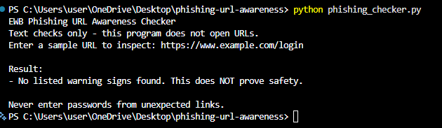
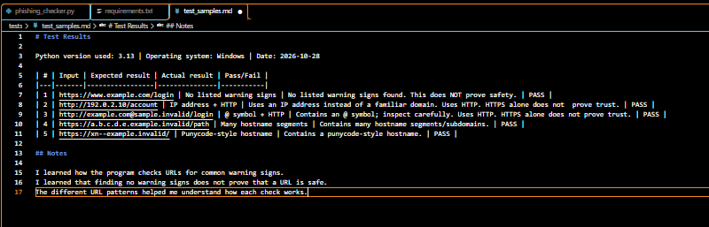

# EWB Phishing URL Awareness Checker

## Overview

Phishing is a type of online scam where attackers use deceptive messages or URLs to trick people into revealing sensitive information. This tool checks the text of a sample URL for common warning signs and helps users review suspicious URLs safely. It does not open URLs or make internet requests.

## Features

- Detects an @ symbol in the URL
- Flags unusually long URLs (over 100 characters)
- Flags IP-address hostnames
- Flags many hostname segments (5 or more)
- Flags punycode-style hostnames (xn--)
- Flags the HTTP scheme
- Allows checking multiple URLs without restarting
- Shows a clear "REVIEW CAREFULLY" message when warning signs are found

## Requirements

Python 3.10 or later. No extra packages.

## How to Run

Windows:

```text
python phishing_checker.py
```

Mac/Linux:

```text
python3 phishing_checker.py
```

## Example Output

```text
EWB Phishing URL Awareness Checker
Text checks only - this program does not open URLs.

Enter a sample URL (or type q to quit): http://192.0.2.10/account

Result:
- Uses an IP address instead of a familiar domain.
- Uses HTTP. HTTPS alone does not prove trust.

REVIEW CAREFULLY: 2 warning sign(s) found.
Never enter passwords from unexpected links.

Enter a sample URL (or type q to quit): q
Goodbye! Stay alert online.
```

## Testing

| # | Input | Expected | Actual | Result |
|---|-------|----------|--------|--------|
| 1 | https://www.example.com/login | No warning signs | No listed warning signs found. This does NOT prove safety. | PASS |
| 2 | http://192.0.2.10/account | IP address + HTTP | Uses an IP address instead of a familiar domain. Uses HTTP. HTTPS alone does not prove trust. | PASS |
| 3 | http://example.com@sample.invalid/login | @ symbol + HTTP | Contains an @ symbol; inspect carefully. Uses HTTP. HTTPS alone does not prove trust. | PASS |
| 4 | https://a.b.c.d.e.example.invalid/path | Many hostname segments | Contains many hostname segments/subdomains. | PASS |
| 5 | https://xn--example.invalid/ | Punycode-style hostname | Contains a punycode-style hostname. | PASS |

Full test details are available in `tests/test_samples.md`.

## Screenshots





## Improvements

1. **Loop with Quit Command** - Added a loop so multiple sample URLs can be checked without restarting the program. The user can type `q`, `quit`, or `exit` to close the program. I tested it by checking multiple URLs in one run and using `q` to exit.

2. **Review Carefully Summary** - Added a `has_warnings()` helper that identifies warning results and displays a clear message showing the number of warning signs found. I tested it with the five Section 08 sample URLs and confirmed that warning messages appeared correctly.

## Limitations

This is an educational tool. It only reads URL text. It does not visit URLs, scan for malware or prove that a URL is safe. No warning signs found does NOT mean a URL is safe.

## Ethical Use

Use sample strings only. Do not collect credentials. Do not use this project to deceive anyone or to test websites without permission.

## Author

Rana Pratap, EWB Courses